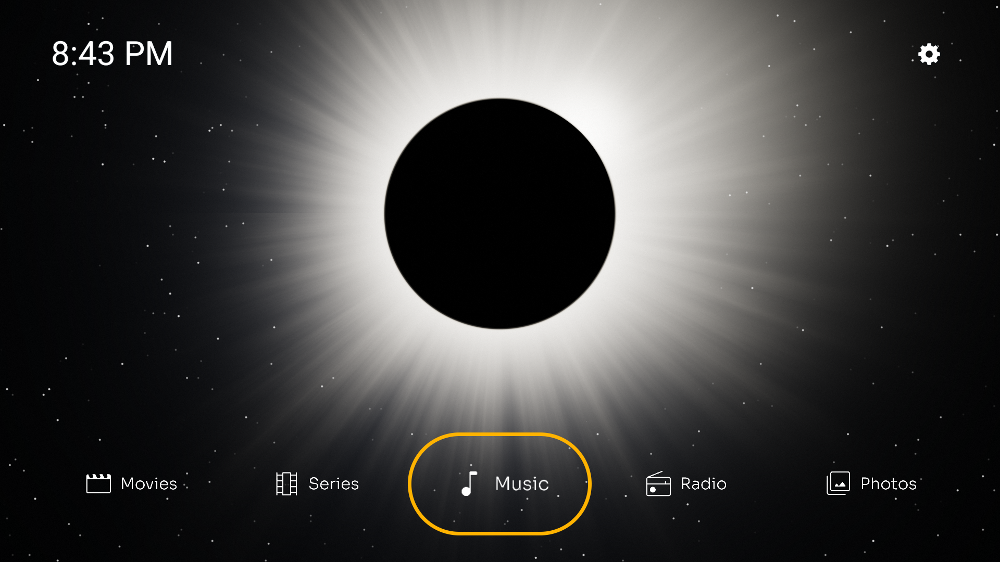
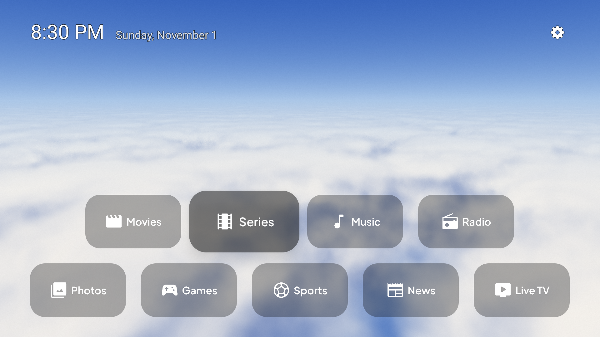
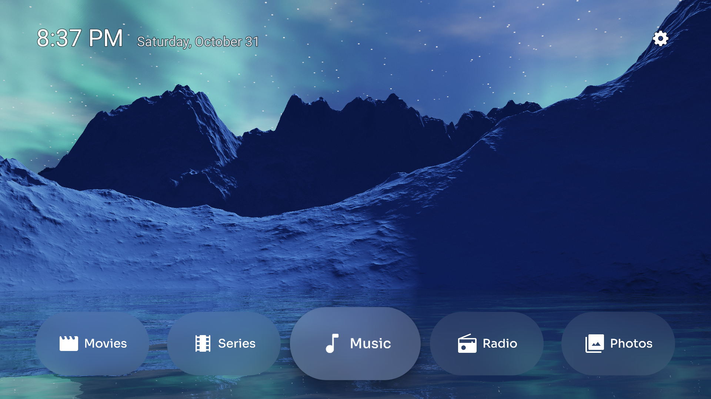
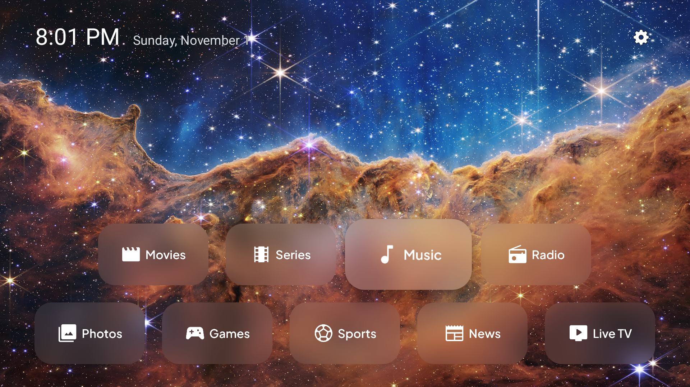
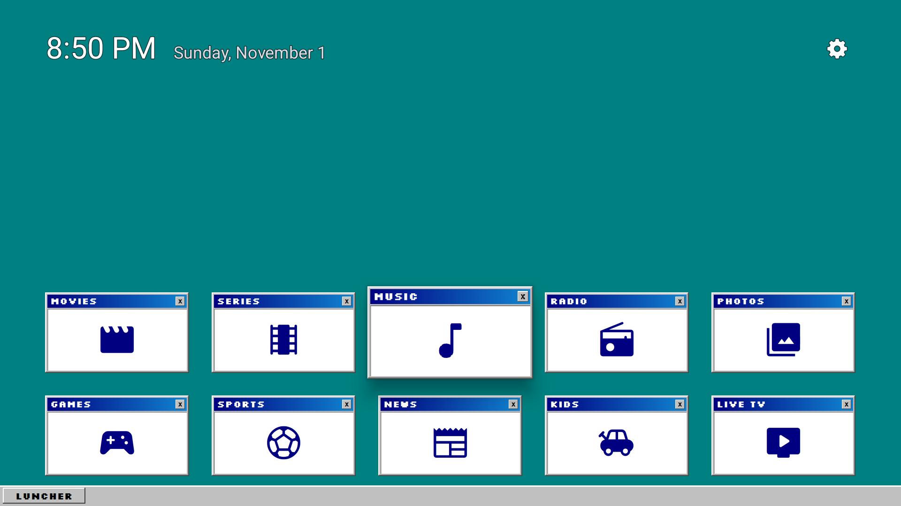
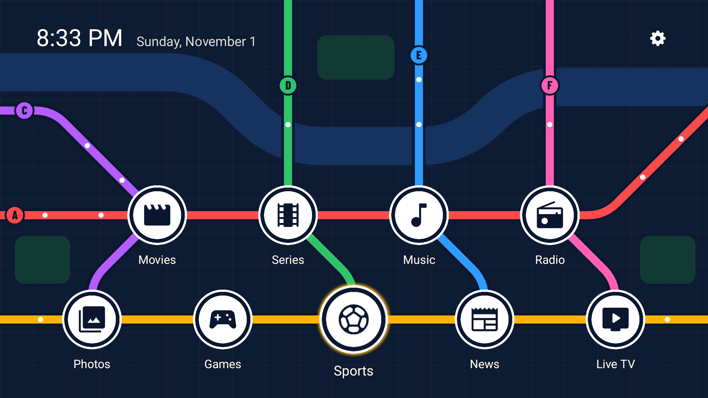
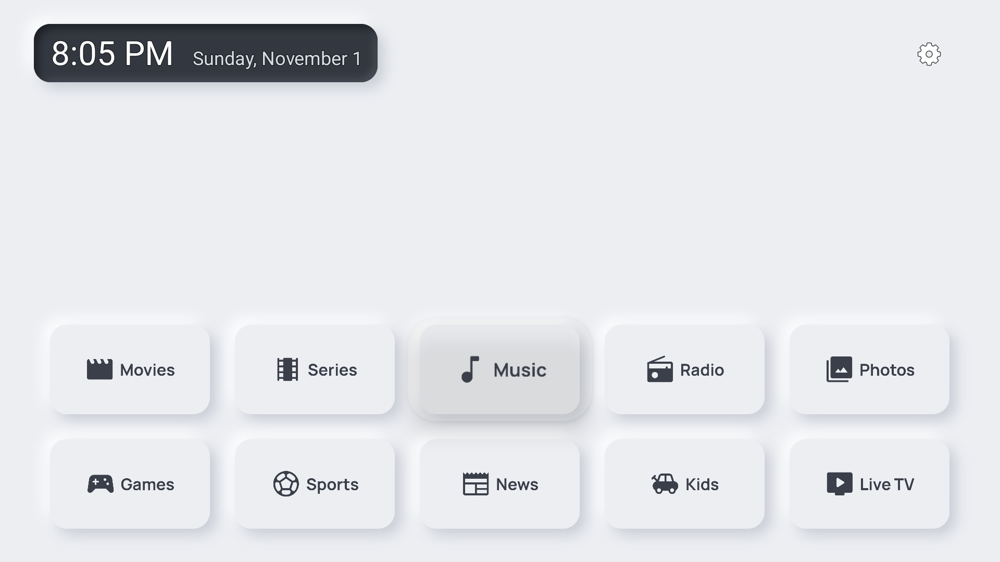
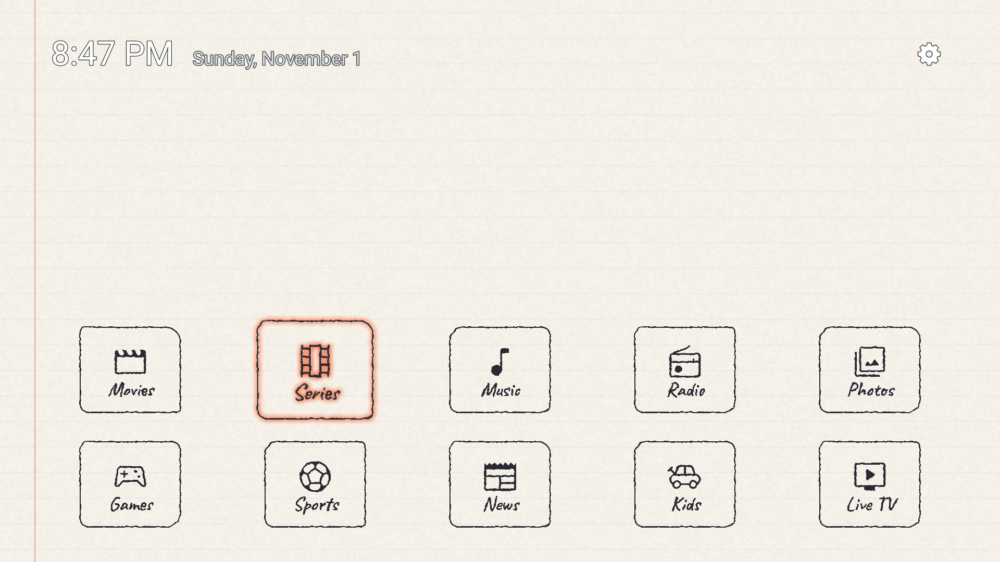
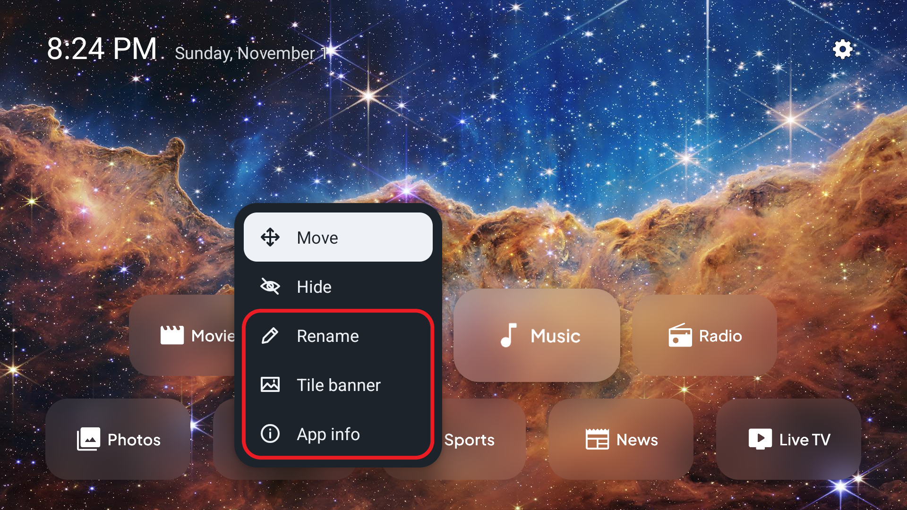
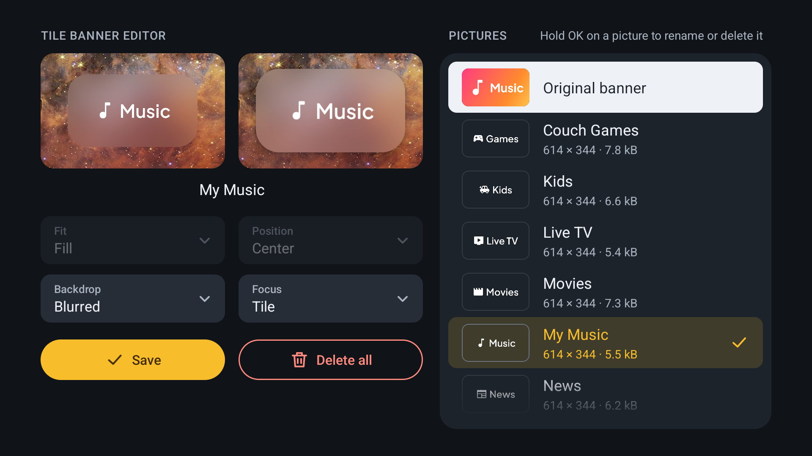

# This is 1.0.0

**With this release, 100% of your home screen is yours to customize.**

The wallpaper, the banner on every tile, the name of every app, the shape of the tiles, the way a tile shows the focus, and more. Reaching this milestone marks the v1.0.0 release. And Luncher still asks for no permissions, still starts instantly, and still has the same look and feel across all Android versions.

Here are a few examples of what you can create:

| | |
|---|---|
|  |  |
| See-through banners | Dark backdrop |
|  |  |
| Pill-shaped tiles | Blurred backdrop |
|  |  |
| Retro desktop | Metro map |
|  |  |
| Porcelain | Sketchbook |

All of these were created with just a custom wallpaper, custom tile banners and the options in Luncher's settings.

## What's new

### Your own banner on any app

Hold OK on an app and choose **Tile banner**, then pick any picture from Luncher's gallery. When a picture has transparent parts, two more options become available:

- **Backdrop:** what shows through the transparent parts. None leaves the home screen's background, Light and Dark put a glass card behind the picture, and Blurred frosts the wallpaper behind the tile.
- **Focus:** whether the focus follows the tile's rounded shape, or the outline of the transparent picture itself.

> [!NOTE]
> To offer the Blurred backdrop without blurring anything live, Luncher needs a blurred copy of your wallpaper, which it computes once and saves. So if you already have a wallpaper set, after updating you'll see an "Updating the background…" window for about 2-3 seconds. This happens only once and doesn't affect the instant startup.

### Rename apps and reach their details

Two more entries in the same menu:

- **Rename:** give any app a name of your own.
- **App info:** go straight to the app's page in the device's settings, for its storage, permissions, force stop or uninstall.

### Sharp on any screen

One of Luncher's goals is to do the heavy work once, save the result, and from then on just reuse it. Say you move a Fire TV Stick from a 720p display to a 4K one. A background made for 720p would look soft there, so Luncher notices the new screen, draws the background and the tile banners again from your original pictures at the new size, once, and stores them. After that short wait, the home screen just reads the result, and everything stays sharp and starts instantly.

### Quick, minimal animations

Android's stock animations were heavy and slow, and they changed from one Android version to the next. Luncher now has its own minimal ones. Navigation feels much snappier, and it feels the same on every version.

## Fixes

- On Android 11, the rename dialog's field is no longer cut in half above the keyboard on small screens.
- Pressing OK while Hide apps' list is sliding no longer leaves its rows out of line.
- The appearance editor's options line up by their widest value, list rows share one height, the picture lists reach down to the bottom margin, and fields stay in place as you change them.

## Thanks

Thanks to [@Yaoser-x](https://github.com/Yaoser-x) for translating Luncher and its README into Simplified Chinese ([#5](https://github.com/CVasilakis/luncher/pull/5)).
