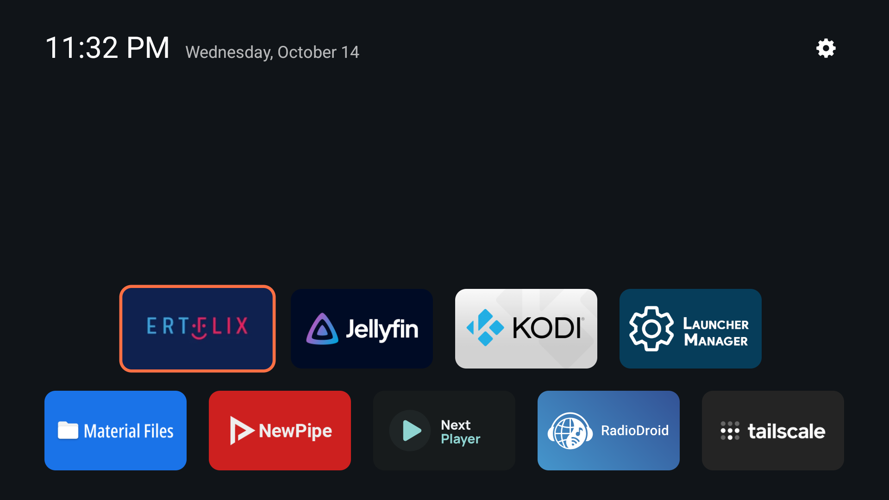
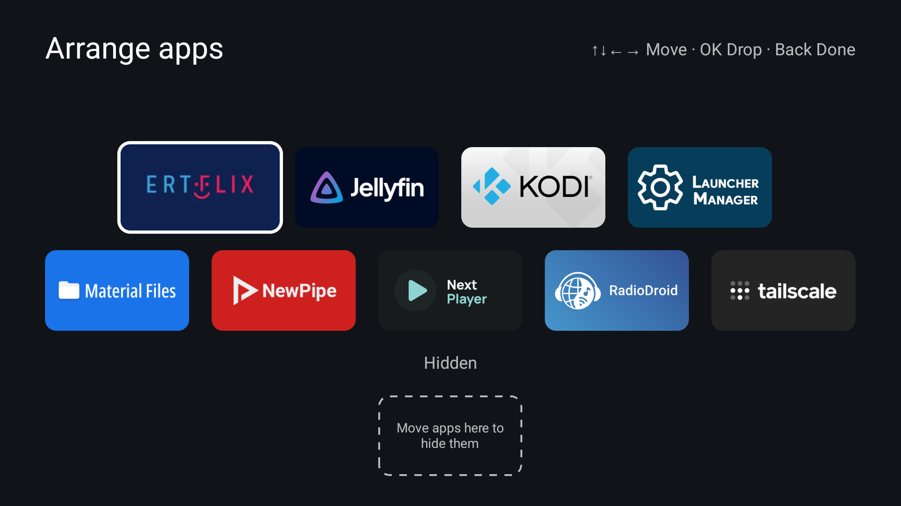
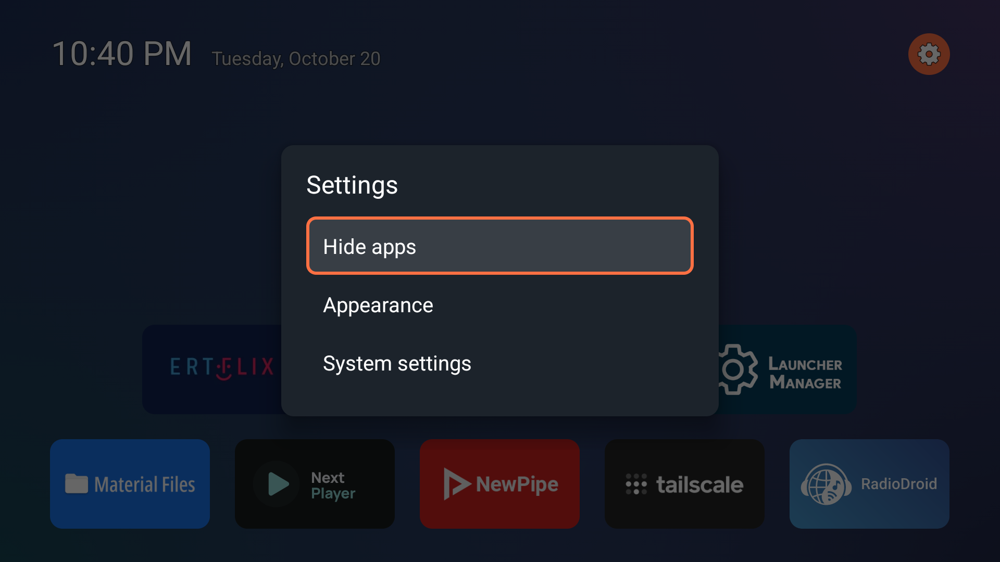
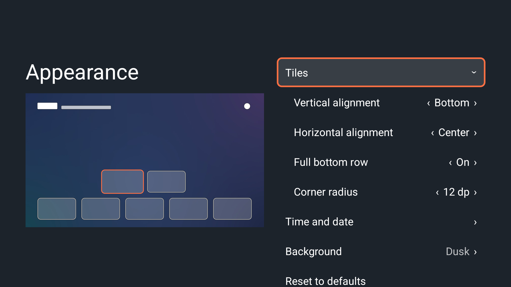
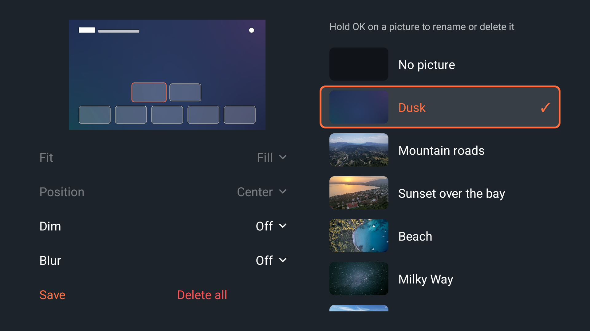
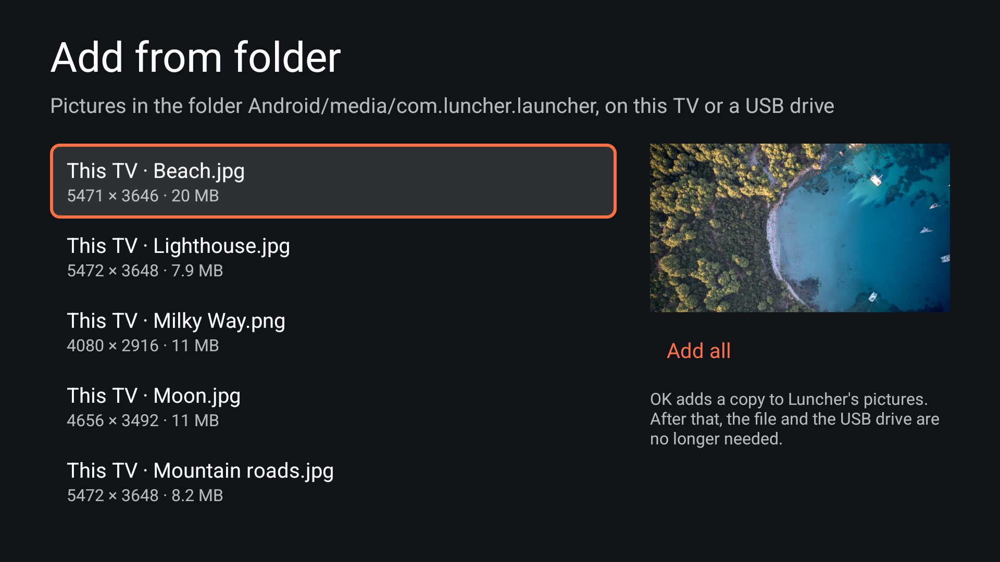

<p align="center">
  
</p>

<p align="center"><b>An offline, lightweight and customizable Android TV launcher that starts instantly.</b></p>

<p align="center">
  
  <a href="https://f-droid.org/packages/com.luncher.launcher/"></a>
  <a href="https://github.com/CVasilakis/luncher/releases/latest"></a>
  
</p>

It's made with performance in mind, to run smoothly even on old and weak Android TV devices, and still gives you plenty of customization options to shape it to your taste.

## Screenshots

| | |
|---|---|
|  |  |
| Your apps, the time and the date | Hold OK on an app to move it |
|  |  |
| Settings | Customize your home screen layout and tile shape |
|  |  |
| Pick a wallpaper, and dim or blur it | Add pictures to Luncher |

## Features

- [x] A status bar with the time, the date and the settings, which you can arrange to your liking
- [x] Your TV apps as a grid of banners, placed where you want on the screen
- [x] Reorder your apps
- [x] Hide the apps you don't use (quickly accessible from the hidden shelf)
- [x] Customize the tile shape, from square to pill-shaped
- [x] Set your own pictures as wallpaper, with dim and blur options

**On the way**

- [ ] Your own custom banners for app tiles
- [ ] More appearance settings: tile size and spacing, accent colors and much more
- [ ] Wi-Fi, VPN and notifications in the status bar, without ever asking for internet access
- [ ] Folders to group your apps
- [ ] A lightweight animated background option (if possible)
- [ ] More exotic features, such as the CPU temperature (if possible)

Have an idea? Suggest it in the [issues](https://github.com/CVasilakis/luncher/issues). If it fits Luncher's [design principles](#design-principles), it has a good chance of joining the list above.

## Design principles

- **Instant startup** and **minimal memory usage**, with no background services.
- **Offline by design:** no internet, no ads, no tracking, no accounts.
- **No frameworks or dependencies:** just plain Kotlin.

## Install

You can download Luncher from any of the sources below. Its builds are
[reproducible](https://f-droid.org/en/docs/Reproducible_Builds/) and signed with my key, so all
three sources offer the exact same app, and you can switch between them for updates without
reinstalling.

<p align="center">
  <a href="https://f-droid.org/packages/com.luncher.launcher/"></a>
  <a href="https://apps.obtainium.imranr.dev/redirect?r=obtainium://add/https://github.com/CVasilakis/luncher"></a>
  <a href="https://github.com/CVasilakis/luncher/releases/latest"></a>
</p>

Once installed, Luncher shows up in your TV's list of apps. You can open it from there to try it out, but the Home button on the remote still takes you back to the TV's own launcher. The steps to make it your default home screen depend on the device. The guides below cover the two most common systems: Google TV, found on many smart TVs, projectors and streaming sticks, and Fire OS, found on Amazon's Fire TV devices. The newest Fire TV devices run Vega OS instead, which can't run Android apps, so Luncher doesn't work on them. Make sure you understand a command before you run it, and if you're unsure, feel free to ask in the [issues](https://github.com/CVasilakis/luncher/issues).

<details>
<summary><b>Google TV</b></summary>

Connect to the TV with adb: turn on USB or network debugging in its developer options (over the
network, connect with `adb connect <TV's IP address>`). Then install the APK you downloaded:

```bash
adb install luncher-vX.Y.Z.apk
```

With the TV's own home screen in front, see which app it is:

```bash
adb shell dumpsys window | grep mCurrentFocus
```

On Android 7.0 and newer, this also works from any screen:

```bash
adb shell cmd package resolve-activity --brief -a android.intent.action.MAIN -c android.intent.category.HOME
```

On Google's own system images, the stock launcher is:

| System | Stock launcher |
|---|---|
| Android TV 5.1 to 7.1 | `com.google.android.leanbacklauncher` |
| Android TV 8.0 and newer | `com.google.android.tvlauncher` |
| Google TV | `com.google.android.apps.tv.launcherx` |

TV makers may replace it with their own, so check with the commands above. Disabling the stock
launcher makes Home open Luncher:

```bash
adb shell pm disable-user --user 0 <package>
```

To undo it, run `adb shell pm enable <package>`. Don't uninstall Luncher while the stock launcher
is disabled, or Home has nowhere to go.

</details>

<details>
<summary><b>Fire TV (Fire OS)</b></summary>

Connect to the Fire TV with adb: turn on ADB debugging in its developer options, then connect with
`adb connect <Fire TV's IP address>`. Then install the APK you downloaded:

```bash
adb install luncher-vX.Y.Z.apk
```

On Fire OS, the simplest way to make Luncher your default home screen is Launcher Manager, an app
made for exactly that:

- [Launcher Manager (for Fire OS)](https://xdaforums.com/t/app-firetv-noroot-launcher-manager-change-launcher-without-root.4176349/) (XDA Forums)

If Launcher Manager doesn't support your Fire OS version, there's currently an exploit that works on
most Fire TV devices: it lets you unlock the bootloader, root your device and even downgrade it to
an older Fire OS version. Look for the "UNLOCK" thread of your device in the forum below:

- [Fire TV Original Android Development](https://xdaforums.com/f/fire-tv-original-android-development.3083/) (XDA Forums)

</details>

## The story behind Luncher

Having recently acquired a second-hand 3rd gen Fire TV Stick, I was immediately impressed by it.
This little device runs Android, can be powered from a typical USB port and has hardware
acceleration for the H.265/H.264 video formats
([specs](https://developer.amazon.com/docs/device-specs/device-specifications-comparison-table.html)).
So many possibilities, but what a bad home screen! I get why the default home screen is like that
(ads everywhere, lagging, too many clicks to reach what you want). After all, every company wants
to promote its products, and that's fair. But I wanted something more minimal and faster, so I
started digging into the open source community for Android TV launcher alternatives.

I was surprised by the limited availability of open source options. Few launchers were still
maintained, and most of the ones on GitHub don't make their source code available (they provide
just the APK for download). Also, while many of them looked fancy, they were quite buggy, or kept
features behind a paywall. A well-maintained list of the available Android TV launchers can be
found [here](https://gist.github.com/denilsonsa/80cbb3a14b3bf63de75e6bf81c89ee05).

At that point I had two options: fork one of the existing open source launchers and try to improve
it, or build a new one from the ground up. Forking would have meant substantial changes, with no
guarantee that the result would end up close to what I wanted. So I went for the second option,
wondering how difficult it could be. With a good knowledge of software architecture principles, a
background in software engineering and, of course, some help from AI agents, it turned out to be
quite easy, and I learned a lot along the way. So here we are. Most of the development time goes
into designing and improving the project's software architecture, to make sure each feature is
implemented in a simple and lightweight manner, and into automating the tests it needs. The
project is currently a hobby that I plan to maintain for the long term. Enjoy!

## For developers

For how to build Luncher, how the code is organized and how it's tested, see
[`docs/`](docs/README.md). If you're developing under WSL2, the
[android-tv-wsl-dev-tools](https://github.com/CVasilakis/android-tv-wsl-dev-tools) scripts create,
start and stop Android TV emulators from the command line, without the need for Android Studio.

## License

Luncher is under the MIT License ([`LICENSE`](LICENSE)), except its icon and banner, the store
listing's images, this page's banner and the archived launch screen's graphics, which are derived
from Android Open Source Project artwork and are under the Apache License 2.0
([`app/README.md`](app/README.md#license)).
