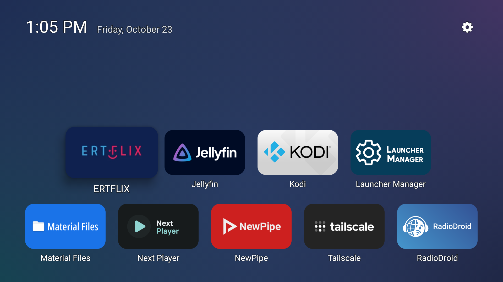
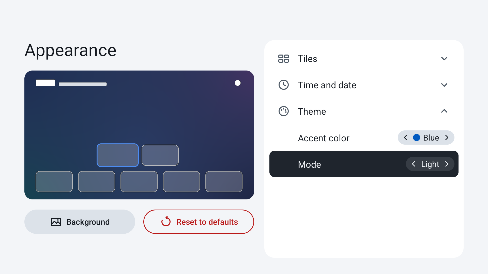

[English](README.md)

<p align="center">
  
</p>

<p align="center"><b>一款离线、轻量、可自定义的 Android TV 桌面，启动迅速。</b></p>

<p align="center">
  
  <a href="https://f-droid.org/packages/com.luncher.launcher/"></a>
  <a href="https://github.com/CVasilakis/luncher/releases/latest"></a>
  
</p>

Luncher 注重性能，即使在较老、性能较弱的 Android TV 设备上也能流畅运行，同时提供丰富的自定义选项，让你按自己的喜好调整桌面。

## 截图

| | |
|---|---|
|  |  |
| 应用、时间和日期 | 长按应用上的 OK 键，可移动或隐藏应用 |
|  |  |
| 设置 | 自定义主页布局和卡片形状 |
|  |  |
| 选择背景图片，并调整明暗或模糊程度 | 将图片添加到图片库 |
|  |  |
| 显示应用名称 | 选择强调色，以及深色或浅色主题 |

## 功能

- [x] 调整应用顺序
- [x] 隐藏不常用的应用
- [x] 自定义卡片形状，从方形到胶囊形
- [x] 调整应用的对齐方式（顶部、底部、左侧、右侧或居中）
- [x] 显示应用名称
- [x] 使用自己的图片作为背景，并调整明暗或模糊程度
- [x] 为菜单和设置选择强调色，以及深色或浅色主题

**计划中的功能**

- [ ] 自定义应用卡片封面
- [ ] 更多外观设置，包括卡片大小、间距等
- [ ] 在状态栏显示 Wi-Fi、VPN 和通知
- [ ] 用文件夹整理应用
- [ ] 屏幕保护设置
- [ ] 轻量的动态背景（如可行）
- [ ] CPU 温度等更多功能（如可行）

有建议或想法，欢迎在 [Issues](https://github.com/CVasilakis/luncher/issues) 中提出。只要符合 Luncher 的[设计原则](#设计原则)，就有机会加入上面的计划。

## 设计原则

- **启动迅速、内存占用少**，不运行后台服务。
- **离线运行**：不联网、无广告、无跟踪，也无需账号。
- **不使用框架或依赖**，只使用 Kotlin。

## 安装

可以从以下任一来源下载 Luncher。构建[可复现](https://f-droid.org/en/docs/Reproducible_Builds/)，并由原作者的密钥签名，因此这三个来源提供的是同一个应用，可以切换下载来源更新，无需重新安装。

<p align="center">
  <a href="https://f-droid.org/packages/com.luncher.launcher/"></a>
  <a href="https://apps.obtainium.imranr.dev/redirect?r=obtainium://add/https://github.com/CVasilakis/luncher"></a>
  <a href="https://github.com/CVasilakis/luncher/releases/latest"></a>
</p>

安装后，Luncher 会出现在电视的应用列表中。你可以从列表中打开试用，但遥控器的主页键仍会返回电视原有的桌面。设为默认桌面的方法因设备而异。下面介绍两种常见系统：许多智能电视、投影仪和电视棒使用的 Google TV，以及亚马逊 Fire TV 设备使用的 Fire OS。最新的 Fire TV 设备改用了 Vega OS，无法运行 Android 应用，因此不支持 Luncher。运行命令前，请先理解它的作用；不确定时，可以在 [Issues](https://github.com/CVasilakis/luncher/issues) 中询问。

<details>
<summary><b>Google TV</b></summary>

先在电视的开发者选项中开启 USB 或网络调试，再通过 adb 连接电视。使用网络连接时，运行 `adb connect <TV's IP address>`。然后安装下载的 APK：

```bash
adb install luncher-vX.Y.Z.apk
```

在电视原有桌面显示时，查看它属于哪个应用：

```bash
adb shell dumpsys window | grep mCurrentFocus
```

在 Android 7.0 及更新版本上，也可以在任意界面运行以下命令：

```bash
adb shell cmd package resolve-activity --brief -a android.intent.action.MAIN -c android.intent.category.HOME
```

Google 原版系统镜像中的默认桌面如下：

| 系统 | 默认桌面 |
|---|---|
| Android TV 5.1 至 7.1 | `com.google.android.leanbacklauncher` |
| Android TV 8.0 及更新版本 | `com.google.android.tvlauncher` |
| Google TV | `com.google.android.apps.tv.launcherx` |

电视厂商可能替换默认桌面，因此请先用上面的命令确认。停用系统桌面后，按主页键就会打开 Luncher：

```bash
adb shell pm disable-user --user 0 <package>
```

要恢复系统桌面，运行 `adb shell pm enable <package>`。系统桌面停用期间，请勿卸载 Luncher，否则主页键将没有可打开的桌面。

</details>

<details>
<summary><b>Fire TV（Fire OS）</b></summary>

先在 Fire TV 的开发者选项中开启 ADB 调试，再运行 `adb connect <Fire TV's IP address>` 连接设备。然后安装下载的 APK：

```bash
adb install luncher-vX.Y.Z.apk
```

在 Fire OS 上，将 Luncher 设为默认桌面最简单的方法是使用专门用于管理默认桌面的 Launcher Manager：

- [Launcher Manager（适用于 Fire OS）](https://xdaforums.com/t/app-firetv-noroot-launcher-manager-change-launcher-without-root.4176349/)（XDA 论坛）

如果 Launcher Manager 不支持你的 Fire OS 版本，目前还有一个适用于多数 Fire TV 设备的漏洞利用方法，可以解锁引导加载程序、获取 root 权限，甚至降级到较早的 Fire OS 版本。在下面的论坛中查找对应设备的“UNLOCK”帖子：

- [Fire TV 原生 Android 开发](https://xdaforums.com/f/fire-tv-original-android-development.3083/)（XDA 论坛）

</details>

## Luncher 的由来

以下为原作者自述。

最近买到一台二手第三代 Fire TV Stick 后，我很快就喜欢上了这个小设备。它运行 Android，普通 USB 接口就能供电，还支持 H.265/H.264 视频硬件解码（[规格](https://developer.amazon.com/docs/device-specs/device-specifications-comparison-table.html)）。能做的事情很多，桌面体验却很糟糕：广告到处都是，操作卡顿，想打开一个应用还要点好几次。我理解默认桌面为什么会这样，毕竟每家公司都想推广自己的产品，这也无可厚非。但我想要更简洁、更快的桌面，于是开始在开源社区寻找 Android TV 桌面的替代方案。

没想到，开源的选择相当有限。仍在维护的桌面应用很少，GitHub 上的大多数项目也不公开源代码，只提供 APK 下载。此外，不少应用虽然外观精致，却有很多问题，或者将部分功能设为付费。这里有一份维护得不错的 [Android TV 桌面应用列表](https://gist.github.com/denilsonsa/80cbb3a14b3bf63de75e6bf81c89ee05)。

当时我有两个选择：复刻现有的开源桌面并改进，或者从头开发一个。复刻需要大量修改，也无法保证最终接近我想要的样子。于是我选择了后者，也想看看这件事究竟有多难。凭借对软件架构原则的了解、软件工程经验，当然还有 AI 代理的一些帮助，实际做起来并不困难，我也从中学到了很多。Luncher 就这样诞生了。开发时间主要用于设计和改进软件架构，让每项功能都以简单、轻量的方式实现，以及为它们编写自动化测试。目前这是我的业余项目，我计划长期维护。希望你喜欢。

## 开发者说明

构建方法、代码组织和测试方式见 [`docs/`](docs/README.md)。如果使用 WSL2 开发，[android-tv-wsl-dev-tools](https://github.com/CVasilakis/android-tv-wsl-dev-tools) 提供了从命令行创建、启动和停止 Android TV 模拟器的脚本，无需 Android Studio。

## 许可协议

Luncher 使用 MIT 许可证（[`LICENSE`](LICENSE)）。图标和应用横幅、应用商店页面的图片、本页横幅，以及归档的启动画面素材除外：这些素材衍生自 Android 开源项目的作品，使用 Apache License 2.0（[`app/README.md`](app/README.md#license)）。
